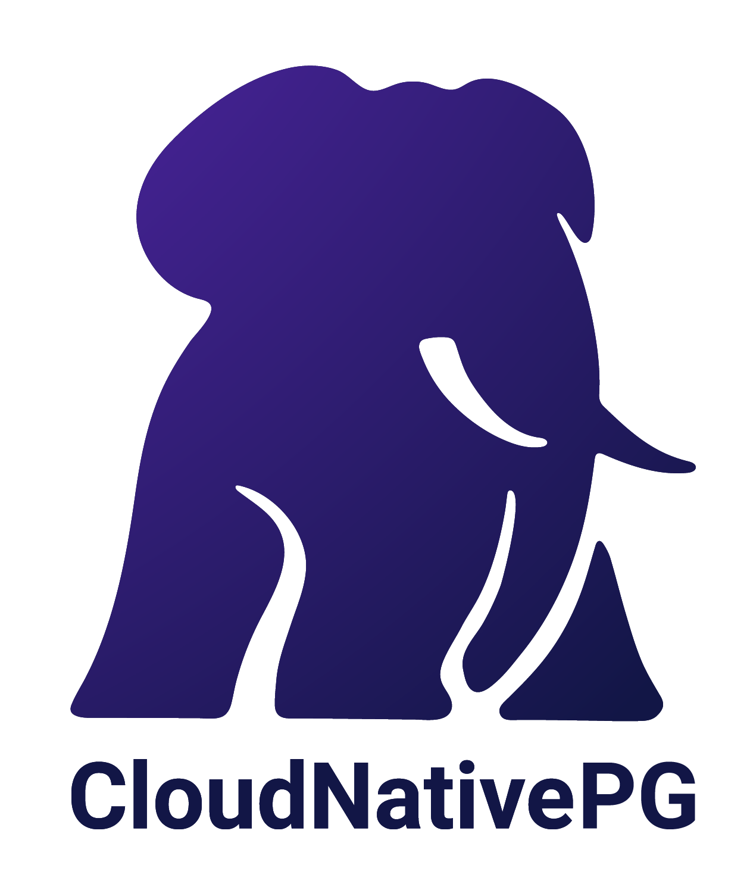

# CloudNativePG Artwork

Here you can find the logo for CloudNativePG, with our mascot *Peggie*.
Peggie is a young female elephant, the daughter of Slonik. She wants
to let the Cloud Native world know about PostgreSQL and how cool it is!

---

## Logos

Every logo is available in SVG (preferred, scales without loss) and PNG,
in three colour variants:

- **color**: the full-colour logo, for light backgrounds
- **black**: single-colour black, for light backgrounds when colour can't be used
- **white**: single-colour white, for dark or coloured backgrounds

| Layout | Color | Black | White |
|---|---|---|---|
| **Horizontal** | [SVG](horizontal/color/cloudnativepg-horizontal-color.svg) · [PNG](horizontal/color/cloudnativepg-horizontal-color.png) | [SVG](horizontal/black/cloudnativepg-horizontal-black.svg) · [PNG](horizontal/black/cloudnativepg-horizontal-black.png) | [SVG](horizontal/white/cloudnativepg-horizontal-white.svg) · [PNG](horizontal/white/cloudnativepg-horizontal-white.png) |
| **Stacked** | [SVG](stacked/color/cloudnativepg-stacked-color.svg) · [PNG](stacked/color/cloudnativepg-stacked-color.png) | [SVG](stacked/black/cloudnativepg-stacked-black.svg) · [PNG](stacked/black/cloudnativepg-stacked-black.png) | [SVG](stacked/white/cloudnativepg-stacked-white.svg) · [PNG](stacked/white/cloudnativepg-stacked-white.png) |
| **Icon** (Peggie only) | [SVG](icon/color/cloudnativepg-icon-color.svg) · [PNG](icon/color/cloudnativepg-icon-color.png) | [SVG](icon/black/cloudnativepg-icon-black.svg) · [PNG](icon/black/cloudnativepg-icon-black.png) | [SVG](icon/white/cloudnativepg-icon-white.svg) · [PNG](icon/white/cloudnativepg-icon-white.png) |

### Horizontal

### Stacked

### Icon

---

## Social media

Pre-sized banners and profile images:

| Platform | Files |
|---|---|
| LinkedIn | [banner](social/linkedin/linkedin-banner.png), [cover](social/linkedin/linkedin-cover.png) |
| Twitter/X | [cover](social/twitter/twitter-cover.png), [profile](social/twitter/twitter-profile.png) |
| YouTube | [banner](social/youtube/youtube-banner.png) |

---

## Author

Peggie and the CloudNativePG logo were created by Scarlett Riggs at EDB.

## Template for slides

- [Google Presentation template](https://docs.google.com/presentation/d/1e4JCPjmrt6RC0yfvgxIZJh6mp04flfRu422KR1fvkvE/edit?usp=sharing)

## Trademarks

*[Postgres, PostgreSQL and the Slonik Logo](https://www.postgresql.org/about/policies/trademarks/)
are trademarks or registered trademarks of the PostgreSQL Community Association
of Canada, and used with their permission.*
